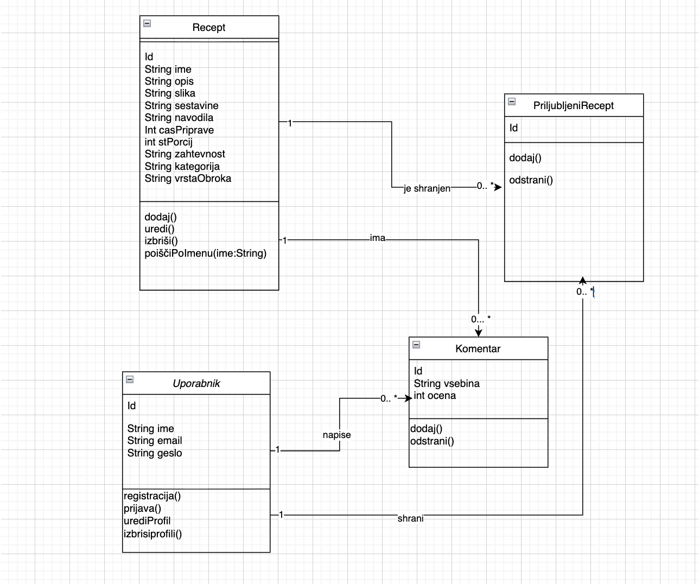

# Recepti

Spletna aplikacija za shranjevanje in urejanje receptov. Projekt je sestavljen iz ločenega frontenda in backenda: Reactov frontend komunicira s Spring Boot REST API-jem, backend pa recepte in uporabniške račune shranjuje v PostgreSQL.

Ivona Duraković Djordjević, Lana Horvat, Nejc Urisek

## Kazalo

- [O projektu](#o-projektu)
- [Uporabniške zgodbe](docs/user-stories.md)
- [Vizija projekta](#vizija-projekta)
- [Uporabljene tehnologije](#uporabljene-tehnologije)
- [Struktura projekta](#struktura-projekta)
- [Predpogoji](#predpogoji)
- [Namestitev in zagon](#namestitev-in-zagon)
- [REST API in Swagger](#rest-api-in-swagger)
- [Navodila za razvijalce](#navodila-za-razvijalce)
- [Standardi kodiranja](#standardi-kodiranja)

## O projektu

Aplikacija omogoča ustvarjanje osebne zbirke receptov. Uporabnik lahko recept doda, si ogleda seznam in podrobnosti, ga uredi ali izbriše. Recept vsebuje ime, opis, sliko, sestavine, korake priprave, čas priprave, število porcij, zahtevnost, kategorije in vrsto obroka.

Glavne funkcionalnosti:

- CRUD operacije nad recepti (ustvari, preberi, posodobi, izbriši).
- Iskanje receptov po imenu, času priprave, kategoriji in vrsti obroka prek API-ja.
- Filtriranje seznama po zahtevnosti, kategoriji in vrsti obroka v frontendu.
- Več kategorij na enem receptu, seznam sestavin in oštevilčeni koraki priprave.
- Slike receptov se v brskalniku pomanjšajo in shranijo skupaj z receptom.
- Registracija, prijava in odjava uporabnika.
- Urejanje profila: sprememba imena in e-pošte ter neobvezna sprememba gesla.
- Dodajanje komentarjev in ocen od 1 (najnižja) do 5 (najvišja) zvezdic ter prikaz povprečne ocene.
- Prijavljeni uporabnik lahko izbriše svoje komentarje.
- Potrditev pred brisanjem in obvestila po uspešnih spremembah.
- Swagger UI za pregled in preizkušanje REST API-ja.

Projekt je namenjen lokalnemu zagonu in študijskemu prikazu. Za urejanje profila, oddajo komentarja ali ocene mora biti uporabnik prijavljen.

## Vizija projekta

### Opis rešitve

Aplikacija za recepte je namenjena ljudem, ki želijo na enem mestu shranjevati, urejati in iskati recepte. Uporabnik lahko doda svoj recept s seznamom sestavin, koraki priprave, fotografijo in drugimi podatki, kot so čas priprave, število porcij, zahtevnost, kategorija in vrsta obroka. Recepte si lahko ogleda v pregledni obliki ter jih razvršča in filtrira glede na izbrane lastnosti.

Namen aplikacije je olajšati organizacijo receptov in načrtovanje priprave jedi. Uporabna je za vsakogar, ki rad kuha, želi zbrati svoje najljubše recepte ali išče idejo za obrok glede na svoje želje.

#### Ključne funkcionalnosti

- Dodajanje, prikaz, urejanje in brisanje receptov.
- Vnos imena, opisa, fotografije, časa priprave, števila porcij in zahtevnosti.
- Dodajanje sestavin in oštevilčenih korakov priprave.
- Izbira kategorij in vrste obroka.
- Iskanje receptov po imenu in filtriranje glede na njihove lastnosti; iskanje je na voljo tudi obiskovalcem.
- Registracija obiskovalca in prijava v uporabniški račun.
- Urejanje osebnega profila, vključno z neobvezno spremembo gesla.
- Dodajanje komentarjev z oceno na lestvici od 1 (najnižja) do 5 (najvišja) zvezdic ter prikaz povprečne ocene; za oddajo je potrebna prijava.
- Shranjevanje receptov v podatkovni bazi PostgreSQL.
- Uporaba spletnega vmesnika za delo z recepti in REST API-ja za povezavo med vmesnikom in zaledjem.

### Obseg rešitve in morebitne omejitve

Aplikacija omogoča upravljanje receptov in njihovo pregledovanje v okviru enega projekta. Vključuje uporabniški vmesnik, zaledni del v Spring Bootu in podatkovno bazo PostgreSQL. Implementirani so registracija, prijava, odjava, urejanje profila, komentarji in ocene receptov. Aplikacija ne omogoča spletnega naročanja sestavin, samodejnega izračuna hranilnih vrednosti ali uvoza receptov z drugih spletnih strani.

Fotografije receptov so odvisne od načina shranjevanja oziroma dostopnosti slik. Za uporabo aplikacije morajo biti zagnani zaledni strežnik, uporabniški vmesnik in podatkovna baza.

## Uporabljene tehnologije

| Del | Tehnologija | Različica / opomba |
|---|---|---|
| Backend | Java | JDK 21 ali novejši; Maven projekt prevaja za Java 21. Lokalno je bil uporabljen JDK 23. |
| Backend | Spring Boot | 4.1.1 |
| Backend | Spring Web MVC | prek Spring Boot odvisnosti |
| Backend | Spring Data JPA / Hibernate | prek Spring Boot odvisnosti |
| Backend | Bean Validation | prek Spring Boot odvisnosti |
| Backend | Spring Security Crypto | BCrypt za varno zgoščevanje gesel |
| Backend | PostgreSQL | 16 |
| Backend | Springdoc OpenAPI / Swagger UI | 3.0.3 |
| Backend | Maven Wrapper | Maven 3.10.0; Maven ni treba namestiti posebej. |
| Frontend | Node.js | 26.12.0 |
| Frontend | React in React DOM | 19.3.1 |
| Frontend | Vite | 8.3.4 |
| Frontend | ESLint | 10.13.0 |

Navedene različice so povzete iz datotek `pom.xml`, `package.json` in `package-lock.json` ter lokalnega razvojnega okolja. Različice frontend paketov so zapisane tudi v `frontend/package-lock.json`, zato namestitev z `npm ci` uporabi zaklenjene različice.

## Struktura projekta

Frontend in backend sta ločena projekta v svojih mapah:

```text
Aplikacija_recepti/
├── backend/
│   ├── src/
│   │   ├── main/java/backend/
│   │   │   ├── BackendApplication.java   # Vstopna točka Spring Boot aplikacije
│   │   │   ├── Recept.java               # JPA entiteta in polja recepta
│   │   │   ├── ReceptController.java     # REST API in CRUD endpointi
│   │   │   ├── ReceptRepository.java     # Dostop do receptov prek JPA
│   │   │   ├── Uporabnik.java            # JPA entiteta uporabniškega računa
│   │   │   ├── UporabnikRepository.java  # Dostop do uporabniških računov
│   │   │   ├── AuthController.java       # Registracija, prijava, profil in odjava
│   │   │   ├── Komentar.java             # Komentar in ocena recepta
│   │   │   ├── KomentarController.java   # Prikaz in upravljanje komentarjev
│   │   │   ├── KomentarRepository.java   # Dostop do komentarjev
│   │   │   ├── AuthNapakaHandler.java    # Berljiva sporočila za neveljavne vnose
│   │   │   └── SpletnaKonfiguracija.java # CORS in uporaba seje iz frontenda
│   │   ├── main/resources/
│   │   │   └── application.properties    # Povezava z bazo in nastavitve backenda
│   │   └── test/java/backend/            # Samodejni testi
│   ├── .mvn/wrapper/                     # Nastavitve Maven Wrapperja
│   ├── mvnw, mvnw.cmd                    # Zagon Maven Wrapperja za macOS/Linux in Windows
│   ├── pom.xml                           # Odvisnosti in nastavitve Maven projekta
│   ├── OAplikaciji.md                     # Dodatni opis aplikacije
│   └── Slike/                             # Slike z dokumentacijo API-ja
├── frontend/
│   ├── public/                           # Statične javne datoteke in ikone
│   ├── src/
│   │   ├── assets/                       # Slike in drugi uvoženi viri
│   │   ├── App.jsx                       # Strani, recepti, komentarji in klici API-ja
│   │   ├── App.css                       # Slogi aplikacije in odzivna postavitev
│   │   ├── AuthModal.jsx                 # Okno za prijavo in registracijo
│   │   ├── AuthModal.css                 # Slogi prijavnega in registracijskega okna
│   │   ├── ProfileModal.jsx               # Urejanje uporabniškega profila
│   │   ├── index.css                     # Osnovni globalni slogi
│   │   └── main.jsx                      # Vstopna točka React aplikacije
│   ├── index.html                        # HTML stran z React korenskim elementom
│   ├── package.json                      # Ukazi in odvisnosti frontenda
│   ├── package-lock.json                 # Zaklenjene različice npm paketov
│   └── vite.config.js                     # Nastavitve Vite razvojnega strežnika
├── .gitignore                            # Datoteke, ki ne sodijo v Git
└── README.md                             # Opis projekta, tehnologij in navodila
```

Recepti se shranjujejo v PostgreSQL tabelo `recept`, uporabniški računi pa v tabelo `uporabnik`. Hibernate tabeli ustvari oziroma posodobi na podlagi JPA entitet.

## Predpogoji

Pred zagonom namesti oziroma pripravi:

1. **JDK 21 ali novejši.** Preveri z `java -version`. Projekt je nastavljen na Java 21.
2. **Node.js in npm.** Preveri z `node --version` in `npm --version`.
3. **PostgreSQL 16** in ukazni orodji `psql` ter `createdb`. Na macOS je uporabljen Homebrew.
4. **Git** za delo z repozitorijem.
5. Spletni brskalnik.

Maven Wrapper je priložen v mapi `backend`, zato ločena namestitev Maven ni potrebna.

## Namestitev in zagon

### 1. Pridobi projekt

Ko je GitHub repozitorij ustvarjen, ga kloniraj:

```sh
git clone https://github.com/UPORABNISKO_IME/aplikacija-recepti.git
cd aplikacija-recepti
```

`UPORABNISKO_IME` zamenjaj s svojim GitHub uporabniškim imenom.

### 2. Zaženi PostgreSQL in pripravi bazo

Na macOS z Homebrew:

```sh
brew services start postgresql@16
```

Bazo ustvari prvič:

```sh
createdb recepti
```

Če baza že obstaja, preskoči `createdb`. Povezavo lahko preveriš z:

```sh
psql -d recepti -c "SELECT current_database();"
```

### 3. Nastavi okoljske spremenljivke in zaženi backend

V prvem terminalu iz korenske mape projekta:

```sh
export DB_URL="jdbc:postgresql://localhost:5432/recepti"
export DB_USERNAME="$(whoami)"
export DB_PASSWORD=""
cd backend
./mvnw spring-boot:run
```

`DB_USERNAME` nastavi na uporabnika PostgreSQL, ki ima dostop do baze. Če tvoj PostgreSQL uporabnik ni enak uporabniškemu imenu macOS, namesto `$(whoami)` vpiši njegovo ime. Če baza zahteva geslo, ga nastavi v `DB_PASSWORD`. Spremenljivke nastavi v istem terminalu, v katerem zaženeš backend.

Ko se v izpisu pokaže, da se je aplikacija zagnala na vratih `8081`, je backend pripravljen. Terminal pusti odprt.

### 4. Namesti pakete in zaženi frontend

V drugem terminalu, iz korenske mape projekta:

```sh
cd frontend
npm ci
npm run dev
```

Odpri naslov, ki ga izpiše Vite, običajno [http://localhost:5173](http://localhost:5173). Frontend pošilja zahteve backendu na `http://localhost:8081/api/recepti`.

### 5. Ustavi aplikaciji

V vsakem terminalu pritisni `Ctrl+C`. PostgreSQL lahko pustiš zagnan; če ga želiš ustaviti:

```sh
brew services stop postgresql@16
```

## REST API in Swagger

Ko backend teče, odpri [Swagger UI](http://localhost:8081/swagger-ui/index.html). API-je lahko tam razširiš, izpolniš podatke in pritisneš **Try it out** ter **Execute**.

| Metoda | Pot | Namen |
|---|---|---|
| `GET` | `/api/recepti` | Vrne vse recepte. |
| `GET` | `/api/recepti/{id}` | Vrne recept z izbranim ID-jem. |
| `POST` | `/api/recepti` | Ustvari recept. |
| `PUT` | `/api/recepti/{id}` | Posodobi obstoječi recept. |
| `DELETE` | `/api/recepti/{id}` | Izbriše recept. |
| `GET` | `/api/recepti/iskanje/ime?ime=...` | Išče po delu imena. |
| `GET` | `/api/recepti/iskanje/cas?doMinut=30` | Vrne recepte do podanega časa priprave. |
| `GET` | `/api/recepti/iskanje/kategorija?kategorija=...` | Išče po kategoriji. |
| `GET` | `/api/recepti/iskanje/obrok?vrsta=...` | Išče po vrsti obroka. |
| `POST` | `/api/auth/registracija` | Ustvari uporabniški račun. |
| `POST` | `/api/auth/prijava` | Preveri podatke in prijavi uporabnika. |
| `GET` | `/api/auth/jaz` | Vrne podatke trenutno prijavljenega uporabnika. |
| `PUT` | `/api/auth/jaz` | Posodobi ime in e-pošto; geslo spremeni, če sta podani trenutno in novo geslo. |
| `GET` | `/api/recepti/{receptId}/komentarji` | Vrne komentarje in ocene recepta. |
| `POST` | `/api/recepti/{receptId}/komentarji` | Doda komentar in oceno prijavljenega uporabnika. |
| `DELETE` | `/api/recepti/{receptId}/komentarji/{komentarId}` | Izbriše komentar prijavljenega uporabnika, če je njegov avtor. |
| `POST` | `/api/auth/odjava` | Odjavi uporabnika. |

Gesla se shranjujejo kot BCrypt zgoščene vrednosti, ne kot navadno besedilo. Prijava uporablja strežniško sejo. Za osebne funkcije mora zahteva vključevati prijavno sejo. Uporabniških gesel ne shranjuj v dokumentacijo ali Git.

## Navodila za razvijalce

1. Repozitorij kloniraj in spremembe pripravljaj v svoji veji, na primer `feature/nov-filter` ali `fix/prikaz-slike`.
2. Spremembe razdeli na manjše commite, kjer vsak commit obravnava eno smiselno nalogo.
3. Preden spremembe združiš v `main`, odpri Pull Request in ga opiši: kaj se je spremenilo, zakaj in kako je bilo preverjeno.
4. Pred pošiljanjem sprememb preveri `git status` in ne dodajaj gesel, lokalnih nastavitev, `node_modules`, `dist` ali `target`.
5. Repozitorij je namenjen javni objavi. V datoteke ne vpisuj osebnih gesel, žetonov ali drugih skrivnosti.

Pri ustvarjanju repozitorija na GitHubu izberi vidnost **Public**. V **Settings → Collaborators** dodaj uporabnika `@cetinaluka` in `@vasilkas`, da bosta imela dostop do projekta.

## Standardi kodiranja

- **Java:** razredi uporabljajo `UpperCamelCase` (`ReceptController`), metode in spremenljivke `lowerCamelCase` (`pridobiVse`). Uporabi štiri presledke za zamik.
- **JavaScript/React:** komponente uporabljajo `UpperCamelCase`, funkcije in spremenljivke `camelCase`. Uporabi dva presledka za zamik.
- **CSS:** imena razredov so opisna in uporabljajo vezaje, na primer `.recept-kartica`.
- Uporabi UTF-8 in ohranjaj slovenske šumnike v prikazanih besedilih.
- Imena naj bodo razumljiva, komentarji pa naj pojasnijo namen ali razlog za manj očiten del kode.
- Sporočila commitov naj bodo kratka in naj povedo, kaj se je spremenilo, na primer `feat: add recipe category filter`, `fix: show uploaded image` ali `docs: update setup guide`.

# Besednjak domenskih izrazov

Besednjak pojasnjuje izraze, ki se pojavljajo v aplikaciji za recepte in njenih primerih uporabe. Izrazi, ki se nanašajo na uporabniške račune, komentarje in ocenjevanje, opisujejo funkcionalnosti aplikacije.

## Recepti in priprava jedi

- **Recept** — zapis jedi, ki vsebuje podatke za njeno izbiro in pripravo: ime, opis, fotografijo, sestavine, navodila, čas priprave, število porcij, zahtevnost, kategorije in vrsto obroka.
- **Sestavina** — živilo ali drug element, potreben za pripravo jedi. Sestavine so navedene pri posameznem receptu.
- **Navodilo za pripravo** — opis opravila pri pripravi jedi. Navodila so razdeljena na zaporedne korake, da jih lahko uporabnik izvede po vrsti.
- **Čas priprave** — predvideno trajanje priprave recepta, izraženo v minutah.
- **Število porcij** — predvideno število porcij, ki jih pripravljeni recept zadostuje.
- **Zahtevnost** — oznaka, ki uporabniku pomaga oceniti, kako zahtevna je priprava recepta; v aplikaciji so uporabljene stopnje lahko, srednje in težko.
- **Kategorija recepta** — oznaka, ki opiše lastnost ali način prehrane, povezan z jedjo, na primer vegetarijansko ali visoko beljakovinsko. Recept ima lahko več kategorij.
- **Vrsta obroka** — oznaka, ki pove, za kateri obrok je jed primerna, na primer zajtrk, kosilo ali večerja.
- **Fotografija recepta** — slika, povezana z receptom, ki uporabniku pomaga prepoznati jed.

## Iskanje in izbira

- **Iskanje receptov** — iskanje receptov po imenu ali delu imena. V primerih uporabe je na voljo prijavljenim in neprijavljenim obiskovalcem.
- **Iskalni niz** — ime ali del imena recepta, ki ga uporabnik vnese za iskanje.
- **Rezultat iskanja** — recept, ki ustreza vnesenemu iskalnemu nizu. Če ni ustreznih receptov, aplikacija prikaže obvestilo, da zadetkov ni.
- **Filter receptov** — način omejevanja prikazanega seznama glede na izbrano lastnost, kot so zahtevnost, kategorija ali vrsta obroka.

## Uporabniki in osebne funkcije

- **Obiskovalec** — oseba, ki uporablja javne dele aplikacije brez prijave. V primerih uporabe lahko išče in pregleduje recepte.
- **Uporabniški račun** — osebni zapis uporabnika, ustvarjen z registracijo. Primeri uporabe predvidevajo podatke, kot so ime, e-poštni naslov in geslo.
- **Registracija** — postopek ustvarjanja novega uporabniškega računa.
- **Prijava** — postopek, pri katerem registrirani uporabnik z e-poštnim naslovom in geslom dostopa do svojega računa.
- **Prijavljen uporabnik** — uporabnik, ki je uspešno opravil prijavo. Urejanje profila ter oddaja ali brisanje lastnega komentarja in ocene so namenjeni prijavljenim uporabnikom.
- **Uporabniška seja** — obdobje, v katerem si aplikacija zapomni, da je uporabnik prijavljen. Po poteku seje se mora uporabnik ponovno prijaviti.
- **Ocena recepta** — vrednost na lestvici od 1 (najnižja) do 5 (najvišja) zvezdic, s katero prijavljeni uporabnik izrazi svoje mnenje o receptu.
- **Povprečna ocena** — povprečje oddanih ocen recepta, prikazano kot pomoč pri izbiri jedi.

## Stanje funkcionalnosti

Iskanje po imenu ter filtri po času priprave, kategoriji in vrsti obroka so na voljo v zalednem delu. V uporabniškem vmesniku so na voljo filtri za zahtevnost, kategorijo in vrsto obroka. Iskalno polje po imenu še ni izdelano.

Komentarje in ocene lahko dodajo prijavljeni uporabniki. Prijavljeni uporabnik lahko izbriše svoj komentar. Profil lahko ureja samo njegov lastnik.

## Diagram primerov uporabe


## Razredni diagram


### Opis razrednega diagrama
Diagram prikazuje štiri glavne razrede aplikacije za recepte.

    •    Recept hrani podatke o receptu, na primer ime, opis, sestavine, navodila in čas priprave. Uporabnik lahko recept doda, uredi, izbriše ali poišče po imenu. 
    
    •    Uporabnik predstavlja osebo z računom. Uporabnik se lahko registrira, prijavi in uredi svoje podatke. Brisanje računa je načrtovana funkcionalnost. Geslo je shranjeno kot zgoščena vrednost.
    
    •    Komentar vsebuje besedilo, oceno od 1 do 5 in datum objave. Vsak komentar je povezan z enim uporabnikom in enim receptom. Uporabnik lahko doda komentar ali izbriše svojega.
    
    •    PriljubljenRecept povezuje uporabnika z receptom, ki ga je shranil med priljubljene. Dodajanje in odstranjevanje priljubljenih receptov sta načrtovani funkcionalnosti.


