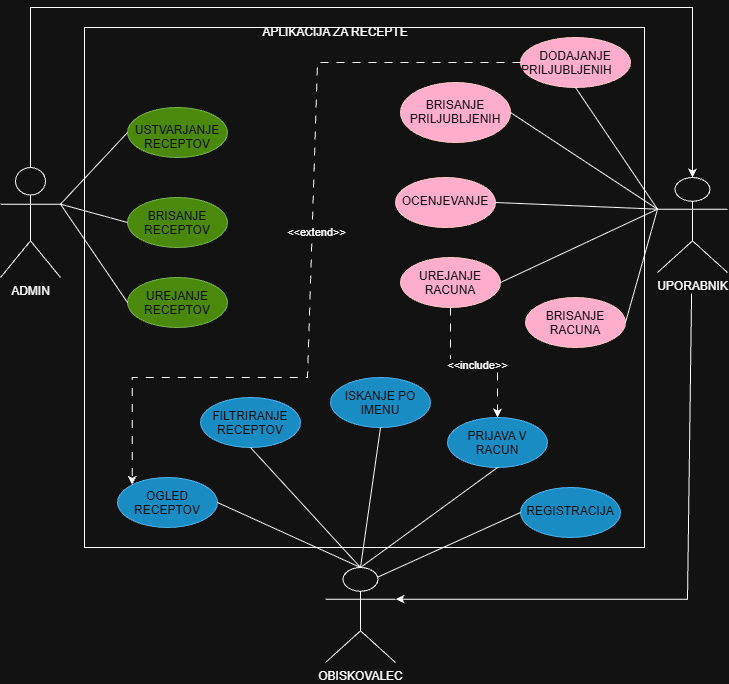

# Recepti

Spletna aplikacija za shranjevanje in urejanje receptov. Projekt je sestavljen iz ločenega frontenda in backenda: Reactov frontend komunicira s Spring Boot REST API-jem, backend pa recepte shranjuje v PostgreSQL.

Ivona Duraković Djordjević, Lana Horvat, Nejc Urisek

## Kazalo

- [O projektu](#o-projektu)
- [Vizija projekta](#vizija-projekta)
- [Uporabljene tehnologije](#uporabljene-tehnologije)
- [Struktura projekta](#struktura-projekta)
- [Predpogoji](#predpogoji)
- [Namestitev in zagon](#namestitev-in-zagon)
- [REST API in Swagger](#rest-api-in-swagger)
- [Navodila za razvijalce](#navodila-za-razvijalce)
- [Standardi kodiranja](#standardi-kodiranja)

## O projektu

Aplikacija omogoča ustvarjanje osebne zbirke receptov. Uporabnik lahko recept doda, si ogleda seznam in podrobnosti, ga uredi ali izbriše. Recept vsebuje ime, opis, sliko, sestavine, korake priprave, čas priprave, število porcij, zahtevnost, kategorije in vrsto obroka.

Glavne funkcionalnosti:

- CRUD operacije nad recepti (ustvari, preberi, posodobi, izbriši).
- Iskanje receptov po imenu, času priprave, kategoriji in vrsti obroka prek API-ja.
- Filtriranje seznama po zahtevnosti, kategoriji in vrsti obroka v frontendu.
- Več kategorij na enem receptu, seznam sestavin in oštevilčeni koraki priprave.
- Slike receptov se v brskalniku pomanjšajo in shranijo skupaj z receptom.
- Swagger UI za pregled in preizkušanje REST API-ja.

Projekt je namenjen lokalnemu zagonu in študijskemu prikazu. Trenutno nima uporabniških računov ali preverjanja prijave.

## Vizija projekta

### Opis rešitve

Aplikacija za recepte je namenjena ljudem, ki želijo na enem mestu shranjevati, urejati in iskati recepte. Uporabnik lahko doda svoj recept s seznamom sestavin, koraki priprave, fotografijo in drugimi podatki, kot so čas priprave, število porcij, zahtevnost, kategorija in vrsta obroka. Recepte si lahko ogleda v pregledni obliki ter jih razvršča in filtrira glede na izbrane lastnosti.

Namen aplikacije je olajšati organizacijo receptov in načrtovanje priprave jedi. Uporabna je za vsakogar, ki rad kuha, želi zbrati svoje najljubše recepte ali išče idejo za obrok glede na svoje želje.

#### Ključne funkcionalnosti

- Dodajanje, prikaz, urejanje in brisanje receptov.
- Vnos imena, opisa, fotografije, časa priprave, števila porcij in zahtevnosti.
- Dodajanje sestavin in oštevilčenih korakov priprave.
- Izbira kategorij in vrste obroka.
- Iskanje receptov po imenu in filtriranje glede na njihove lastnosti; iskanje je na voljo tudi obiskovalcem.
- Registracija obiskovalca in prijava v uporabniški račun.
- Dodajanje receptov med priljubljene in odstranjevanje iz priljubljenih ter ocenjevanje receptov; ti možnosti sta na voljo samo prijavljenim uporabnikom.
- Shranjevanje receptov v podatkovni bazi PostgreSQL.
- Uporaba spletnega vmesnika za delo z recepti in REST API-ja za povezavo med vmesnikom in zaledjem.

### Obseg rešitve in morebitne omejitve

Aplikacija omogoča upravljanje receptov in njihovo pregledovanje v okviru enega projekta. Vključuje uporabniški vmesnik, zaledni del v Spring Bootu in podatkovno bazo PostgreSQL. Registracija in prijava, upravljanje priljubljenih receptov ter ocenjevanje so del vizije in v trenutni različici še niso implementirani. Prav tako aplikacija ne omogoča spletnega naročanja sestavin, samodejnega izračuna hranilnih vrednosti ali uvoza receptov z drugih spletnih strani.

Fotografije receptov so odvisne od načina shranjevanja oziroma dostopnosti slik. Za uporabo aplikacije morajo biti zagnani zaledni strežnik, uporabniški vmesnik in podatkovna baza.

## Uporabljene tehnologije

| Del | Tehnologija | Različica / opomba |
|---|---|---|
| Backend | Java | JDK 21 ali novejši; Maven projekt prevaja za Java 21. Lokalno je bil uporabljen JDK 23. |
| Backend | Spring Boot | 4.1.1 |
| Backend | Spring Web MVC | prek Spring Boot odvisnosti |
| Backend | Spring Data JPA / Hibernate | prek Spring Boot odvisnosti |
| Backend | Bean Validation | prek Spring Boot odvisnosti |
| Backend | PostgreSQL | 16 |
| Backend | Springdoc OpenAPI / Swagger UI | 3.0.3 |
| Backend | Maven Wrapper | Maven 3.10.0; Maven ni treba namestiti posebej. |
| Frontend | Node.js | 26.12.0 |
| Frontend | React in React DOM | 19.3.1 |
| Frontend | Vite | 8.3.4 |
| Frontend | ESLint | 10.13.0 |

Navedene različice so povzete iz datotek `pom.xml`, `package.json` in `package-lock.json` ter lokalnega razvojnega okolja. Različice frontend paketov so zapisane tudi v `frontend/package-lock.json`, zato namestitev z `npm ci` uporabi zaklenjene različice.

## Struktura projekta

Frontend in backend sta ločena projekta v svojih mapah:

```text
Aplikacija_recepti/
├── backend/
│   ├── src/
│   │   ├── main/java/backend/
│   │   │   ├── BackendApplication.java   # Vstopna točka Spring Boot aplikacije
│   │   │   ├── Recept.java               # JPA entiteta in polja recepta
│   │   │   ├── ReceptController.java     # REST API in CRUD endpointi
│   │   │   └── ReceptRepository.java     # Dostop do receptov prek JPA
│   │   ├── main/resources/
│   │   │   └── application.properties    # Povezava z bazo in nastavitve backenda
│   │   └── test/java/backend/            # Samodejni testi
│   ├── .mvn/wrapper/                     # Nastavitve Maven Wrapperja
│   ├── mvnw, mvnw.cmd                    # Zagon Maven Wrapperja za macOS/Linux in Windows
│   ├── pom.xml                           # Odvisnosti in nastavitve Maven projekta
│   ├── OAplikaciji.md                     # Dodatni opis aplikacije
│   └── Slike/                             # Slike z dokumentacijo API-ja
├── frontend/
│   ├── public/                           # Statične javne datoteke in ikone
│   ├── src/
│   │   ├── assets/                       # Slike in drugi uvoženi viri
│   │   ├── App.jsx                       # Strani, obrazec, filtri in klici API-ja
│   │   ├── App.css                       # Slogi aplikacije in odzivna postavitev
│   │   ├── index.css                     # Osnovni globalni slogi
│   │   └── main.jsx                      # Vstopna točka React aplikacije
│   ├── index.html                        # HTML stran z React korenskim elementom
│   ├── package.json                      # Ukazi in odvisnosti frontenda
│   ├── package-lock.json                 # Zaklenjene različice npm paketov
│   └── vite.config.js                     # Nastavitve Vite razvojnega strežnika
├── .gitignore                            # Datoteke, ki ne sodijo v Git
└── README.md                             # Opis projekta, tehnologij in navodila
```

Podatki se shranjujejo v PostgreSQL tabelo `recept`. Hibernate tabelo ustvari oziroma posodobi na podlagi JPA entitete `Recept`.

## Predpogoji

Pred zagonom namesti oziroma pripravi:

1. **JDK 21 ali novejši.** Preveri z `java -version`. Projekt je nastavljen na Java 21.
2. **Node.js in npm.** Preveri z `node --version` in `npm --version`.
3. **PostgreSQL 16** in ukazni orodji `psql` ter `createdb`. Na macOS je uporabljen Homebrew.
4. **Git** za delo z repozitorijem.
5. Spletni brskalnik.

Maven Wrapper je priložen v mapi `backend`, zato ločena namestitev Maven ni potrebna.

## Namestitev in zagon

### 1. Pridobi projekt

Ko je GitHub repozitorij ustvarjen, ga kloniraj:

```sh
git clone https://github.com/UPORABNISKO_IME/aplikacija-recepti.git
cd aplikacija-recepti
```

`UPORABNISKO_IME` zamenjaj s svojim GitHub uporabniškim imenom.

### 2. Zaženi PostgreSQL in pripravi bazo

Na macOS z Homebrew:

```sh
brew services start postgresql@16
```

Bazo ustvari prvič:

```sh
createdb recepti
```

Če baza že obstaja, preskoči `createdb`. Povezavo lahko preveriš z:

```sh
psql -d recepti -c "SELECT current_database();"
```

### 3. Nastavi okoljske spremenljivke in zaženi backend

V prvem terminalu iz korenske mape projekta:

```sh
export DB_URL="jdbc:postgresql://localhost:5432/recepti"
export DB_USERNAME="$(whoami)"
export DB_PASSWORD=""
cd backend
./mvnw spring-boot:run
```

`DB_USERNAME` nastavi na uporabnika PostgreSQL, ki ima dostop do baze. Če tvoj PostgreSQL uporabnik ni enak uporabniškemu imenu macOS, namesto `$(whoami)` vpiši njegovo ime. Če baza zahteva geslo, ga nastavi v `DB_PASSWORD`. Spremenljivke nastavi v istem terminalu, v katerem zaženeš backend.

Ko se v izpisu pokaže, da se je aplikacija zagnala na vratih `8080`, je backend pripravljen. Terminal pusti odprt.

### 4. Namesti pakete in zaženi frontend

V drugem terminalu, iz korenske mape projekta:

```sh
cd frontend
npm ci
npm run dev
```

Odpri naslov, ki ga izpiše Vite, običajno [http://localhost:5173](http://localhost:5173). Frontend pošilja zahteve backendu na `http://localhost:8080/api/recepti`.

### 5. Ustavi aplikaciji

V vsakem terminalu pritisni `Ctrl+C`. PostgreSQL lahko pustiš zagnan; če ga želiš ustaviti:

```sh
brew services stop postgresql@16
```

## REST API in Swagger

Ko backend teče, odpri [Swagger UI](http://localhost:8080/swagger-ui/index.html). API-je lahko tam razširiš, izpolniš podatke in pritisneš **Try it out** ter **Execute**.

| Metoda | Pot | Namen |
|---|---|---|
| `GET` | `/api/recepti` | Vrne vse recepte. |
| `GET` | `/api/recepti/{id}` | Vrne recept z izbranim ID-jem. |
| `POST` | `/api/recepti` | Ustvari recept. |
| `PUT` | `/api/recepti/{id}` | Posodobi obstoječi recept. |
| `DELETE` | `/api/recepti/{id}` | Izbriše recept. |
| `GET` | `/api/recepti/iskanje/ime?ime=...` | Išče po delu imena. |
| `GET` | `/api/recepti/iskanje/cas?doMinut=30` | Vrne recepte do podanega časa priprave. |
| `GET` | `/api/recepti/iskanje/kategorija?kategorija=...` | Išče po kategoriji. |
| `GET` | `/api/recepti/iskanje/obrok?vrsta=...` | Išče po vrsti obroka. |

## Navodila za razvijalce

1. Repozitorij kloniraj in spremembe pripravljaj v svoji veji, na primer `feature/nov-filter` ali `fix/prikaz-slike`.
2. Spremembe razdeli na manjše commite, kjer vsak commit obravnava eno smiselno nalogo.
3. Preden spremembe združiš v `main`, odpri Pull Request in ga opiši: kaj se je spremenilo, zakaj in kako je bilo preverjeno.
4. Pred pošiljanjem sprememb preveri `git status` in ne dodajaj gesel, lokalnih nastavitev, `node_modules`, `dist` ali `target`.
5. Repozitorij je namenjen javni objavi. V datoteke ne vpisuj osebnih gesel, žetonov ali drugih skrivnosti.

Pri ustvarjanju repozitorija na GitHubu izberi vidnost **Public**. V **Settings → Collaborators** dodaj uporabnika `@cetinaluka` in `@vasilkas`, da bosta imela dostop do projekta.

## Standardi kodiranja

- **Java:** razredi uporabljajo `UpperCamelCase` (`ReceptController`), metode in spremenljivke `lowerCamelCase` (`pridobiVse`). Uporabi štiri presledke za zamik.
- **JavaScript/React:** komponente uporabljajo `UpperCamelCase`, funkcije in spremenljivke `camelCase`. Uporabi dva presledka za zamik.
- **CSS:** imena razredov so opisna in uporabljajo vezaje, na primer `.recept-kartica`.
- Uporabi UTF-8 in ohranjaj slovenske šumnike v prikazanih besedilih.
- Imena naj bodo razumljiva, komentarji pa naj pojasnijo namen ali razlog za manj očiten del kode.
- Sporočila commitov naj bodo kratka in naj povedo, kaj se je spremenilo, na primer `feat: add recipe category filter`, `fix: show uploaded image` ali `docs: update setup guide`.

## Diagram primerov uporabe

