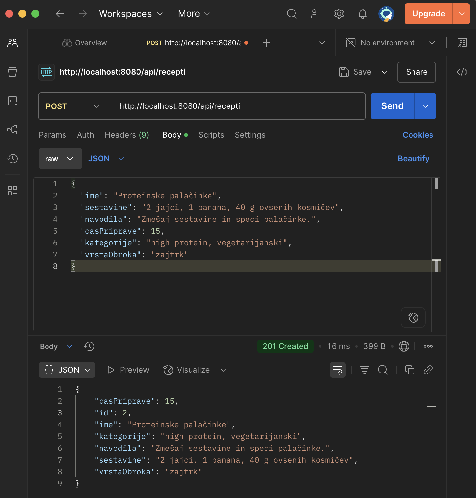
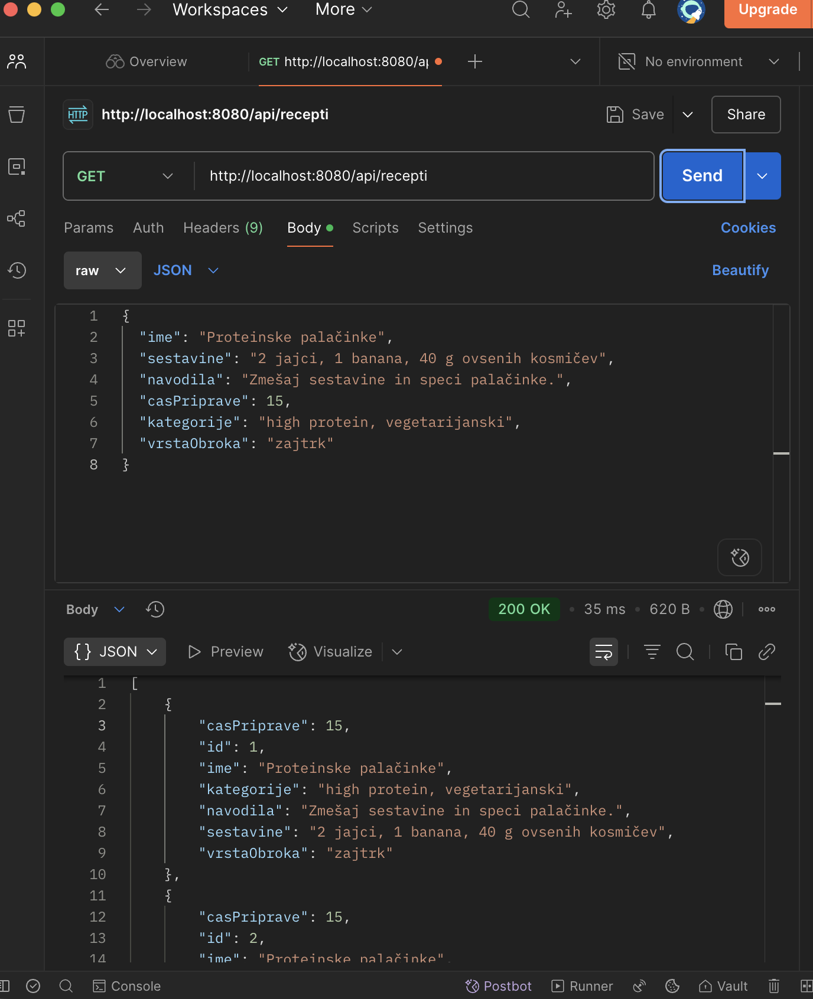
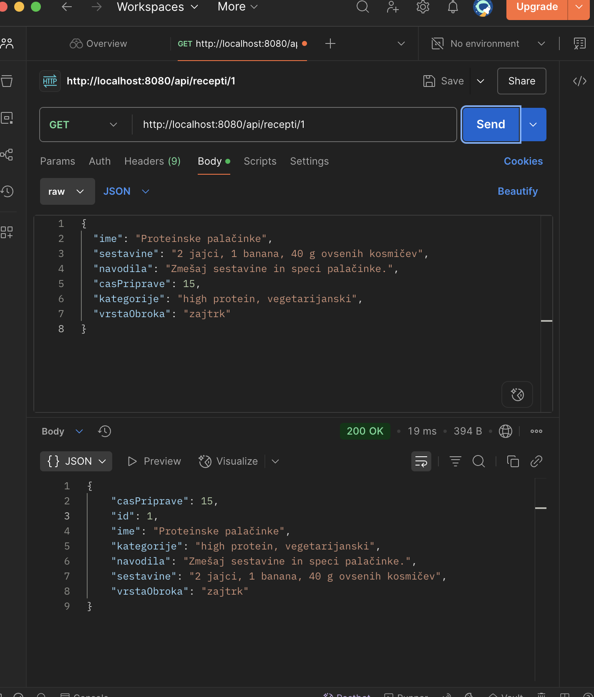
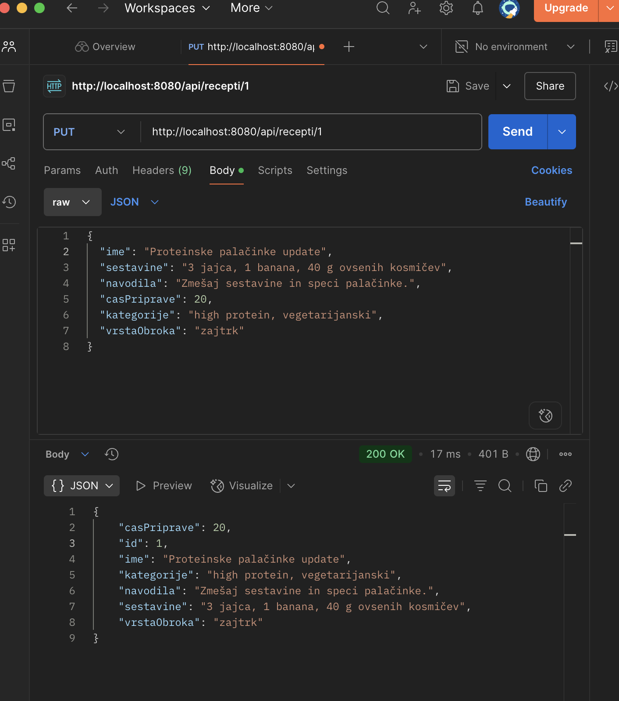
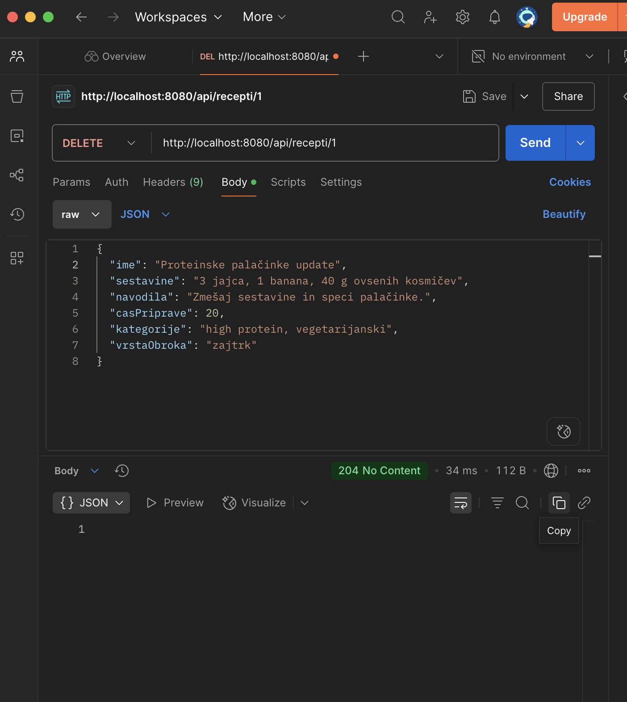

## Aplikacija z recepti

Aplikacija omogoča pregled, dodajanje, urejanje in brisanje receptov. Recept vsebuje ime, opis, sliko, sestavine, korake priprave, čas priprave, število porcij, zahtevnost, kategorije in vrsto obroka. Recepti so razvrščeni po kategorijah, kot so vegansko, vegetarijansko in visoko beljakovinsko, mogoče pa jih je filtrirati tudi po zahtevnosti in vrsti obroka.

## Primeri uporabe REST API-ja

Slike prikazujejo primere CRUD klicev v Swagger UI.
## Dodajanje recepta (POST)
Zahteva: `POST http://localhost:8080/api/recepti`


## Pridobivanje vseh receptov (GET)
Zahteva: `GET http://localhost:8080/api/recepti`


## Pridobivanje enega recepta (GET)
Zahteva: `GET http://localhost:8080/api/recepti/1`


## Posodabljanje recepta (PUT)
Zahteva: `PUT http://localhost:8080/api/recepti/1`


## Brisanje recepta (DELETE)
Zahteva: `DELETE http://localhost:8080/api/recepti/1`



Recept za proteiske palačinke: 
{
  "ime": "Proteinske palačinke",
  "sestavine": "2 jajci, 1 banana, 40 g ovsenih kosmičev",
  "navodila": "Zmešaj sestavine in speci palačinke.",
  "casPriprave": 20,
  "kategorije": "high protein, vegetarijanski",
  "vrstaObroka": "zajtrk"
}

Zagon backenda iz korenske mape projekta:
```sh
cd backend
./mvnw spring-boot:run
```

novi terminal za front: 
Aplikacija_recepti % psql -d recepti -c "\dt"
Dodajanje recepta: curl -i -X POST http://localhost:8080/api/recepti \
  -H "Content-Type: application/json" \
  -d '{"ime":"Testne palačinke","sestavine":"200 g moke, 300 ml mleka, 2 jajci","navodila":"Zmešaj sestavine in speci palačinke.","casPriprave":20,"kategorije":"sladice","vrstaObroka":"zajtrk"}'
Read za vse recepte: curl -i http://localhost:8080/api/recepti
En recept po idju: curl -i http://localhost:8080/api/recepti/1
Update: curl -i -X PUT http://localhost:8080/api/recepti/1 \
  -H "Content-Type: application/json" \
  -d '{"ime":"Hitre palačinke","sestavine":"200 g moke, 300 ml mleka, 2 jajci","navodila":"Zmešaj sestavine in speci palačinke.","casPriprave":15,"kategorije":"sladice","vrstaObroka":"zajtrk"}'
Izbris: curl -i -X DELETE http://localhost:8080/api/recepti/1

brskalnik za backend na: http://localhost:8080/swagger-ui/index.html
brskalnik za frontend na:  http://localhost:5173/
